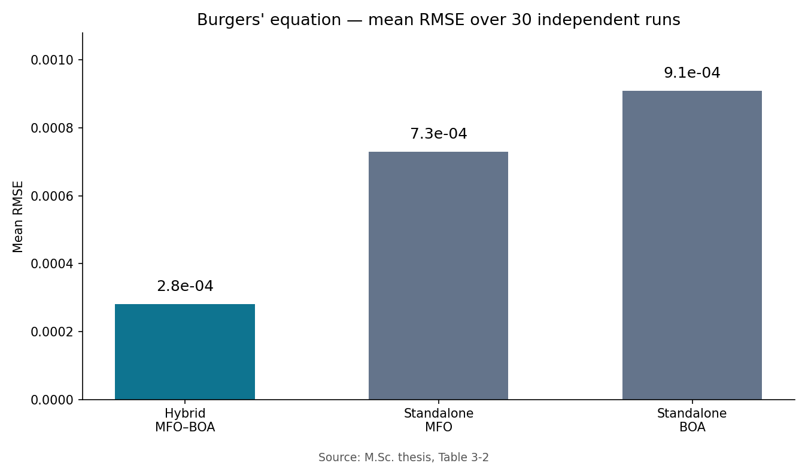

[](https://doi.org/10.5281/zenodo.24222697)
# MFO-BOA-PDE-Solver

Hybrid Moth-Flame Optimization (MFO) + Butterfly Optimization Algorithm (BOA) with B-spline collocation for solving nonlinear partial differential equations. M.Sc. thesis code, Damghan University (2026).

## What it does

- Searches PDE-solver configurations with a hybrid MFO–BOA metaheuristic.
- Discretizes with B-spline / cubic-spline collocation (`scipy.interpolate.BSpline`, `CubicSpline`).
- `src/mfo_boa_pde/`: the solver as an installable package (public API `main`, `run_one`, `run_seed`); `notebook_code.py`: a thin launcher that runs the package; `diag_eansatz2.py`: E-ansatz diagnostic — `(1-e^(-t))` envelope + exact boundary condition `u(x,0) = sin(x)`.

## Results

Burgers' equation: the hybrid MFO–BOA optimizer reduced RMSE by 62% versus standalone MFO and by 69% versus standalone BOA. Wilcoxon signed-rank tests: p = 0.003 versus MFO and p = 0.001 versus BOA. These results are from the M.Sc. thesis; this repository does not include a PINN baseline experiment.



| Method | Mean RMSE |
|---|---|
| Hybrid MFO–BOA | 2.8e-4 |
| Standalone MFO | 7.3e-4 |
| Standalone BOA | 9.1e-4 |

Mean RMSE on Burgers' equation over 30 independent runs (thesis Table 3-2).

## Requirements

- Python 3.12, NumPy, SciPy, pandas, matplotlib; IPython for display; joblib optional (falls back to sequential execution).

## Testing

The repository includes a test suite based on Python's standard-library `unittest` framework.

Run the tests from the repository root:

```bash
python -m unittest discover -s tests -v
```

The suite contains 27 tests and exercises the DEMO execution, numerical validation checks, result artifacts, diagnostic behavior, import safety, legacy entry-point compatibility, and DEMO numerical equivalence against the recorded baseline in `docs/migration/`.

**Expected successful summary:**

```text
Ran 27 tests in [elapsed time]

OK
```

The actual execution time depends on the machine and environment. The DEMO subprocess can take several minutes.

The tests require the dependencies specified in `pyproject.toml` (or `requirements.txt`, kept synchronized) and Python 3.12. The test suite runs the solver in temporary directories to avoid contamination from existing checkpoint files.

A passing test suite verifies the tested implementation and its regression checks. It does not establish reproduction of the thesis-reported Burgers' equation results.

## Installation

```bash
git clone https://github.com/Reza-S80/MFO-BOA-PDE-Solver.git
cd MFO-BOA-PDE-Solver
pip install -e .
```

For the optional parallel path (joblib), install the `parallel` extra instead:

```bash
pip install -e ".[parallel]"
```

## Usage

Run the demo benchmark (NB_MODE=DEMO by default), or the full experiment with NB_MODE=FULL. The diagnostic imports the package directly; it still accepts an optional script path argument for compatibility:

```bash
python notebook_code.py
NB_MODE=FULL python notebook_code.py
python diag_eansatz2.py notebook_code.py
```

## Reproducibility and experimental provenance

### Random seed policy

The solver uses a deterministic seed-generation policy.

- The master seed is defined by `MASTER_SEED = 20261021` in `src/mfo_boa_pde/config.py`.
- The `run_seed(key, run, tag=0)` function derives a run-specific seed using NumPy's `SeedSequence`.
- Seed derivation depends on the problem identifier, run index, and tag.
- Each optimization run initializes its random-number generator with `np.random.default_rng(seed)`.
- The seed is independent of execution order, allowing sequential and joblib-based parallel execution to use the same run-specific random seeds.

The default DEMO configuration uses three runs and a smaller population and evaluation budget. The FULL configuration uses 30 runs, a population of 50, and 200 update generations.

### What this repository regenerates

Running `notebook_code.py` executes the implemented solver and its validation workflow. Depending on the selected configuration, it generates computational outputs, including optimization results and diagnostic artifacts.

The repository also includes a separate E-ansatz diagnostic script, `diag_eansatz2.py`.

The test suite verifies solver machinery, execution behavior, numerical constraints, and recorded DEMO regression behavior. It does not establish that the published thesis experiment has been independently reproduced.

### Thesis-reported results versus repository-generated results

The Burgers' equation mean RMSE values displayed in the README are reported from M.Sc. thesis Table 3-2:

| Method | Mean RMSE |
|---|---:|
| Hybrid MFO–BOA | 2.8e-4 |
| MFO | 7.3e-4 |
| BOA | 9.1e-4 |

These are thesis-reported results over 30 independent runs. They are not presented as results independently regenerated by the current repository test suite.

Per-run raw experimental records are not currently provided in this repository. Consequently, individual run values, individual seeds, and run-level statistical distributions should not be inferred from the reported means.

In particular, the DEMO configuration is not a reproduction of thesis Table 3-2. Running the FULL configuration should not be interpreted as guaranteeing reproduction of those published Burgers' equation results.

### Thesis reference

The associated M.Sc. thesis is:

*Solving Nonlinear Partial Differential Equations Using the Hybrid Moth-Flame and Butterfly Metaheuristic Algorithm and Its Applications in Engineering Problems.*

Damghan University, 2026.

The thesis is the primary reference for the reported experimental results. The repository provides the available implementation, execution workflow, and validation tests.

## API reference

The solver is the installable package `mfo_boa_pde` (`src/mfo_boa_pde/`).
`notebook_code.py` is a thin launcher that runs `mfo_boa_pde.experiment.main()`.
Importing the package is side-effect free; the public API is `main`,
`run_one` and `run_seed` (re-exported from `mfo_boa_pde`).

The following functions are available in the package.

### `run_seed(key, run, tag=0)`

Generates a deterministic integer seed for an optimization run.

**Parameters:**
- `key`: Problem identifier used to select the PDE problem.
- `run`: Run index.
- `tag`: Optional seed namespace, defaulting to `0`.

**Returns:** An integer seed generated using NumPy's `SeedSequence`.

The seed depends on the master seed, the problem identifier, the run index, and the tag.

### `lstsq_fit(M, Uref, xv, tv)`

Computes a least-squares approximation of a reference solution using the design matrix supplied by the solver's machine object.

**Parameters:**
- `M`: Solver machine object exposing `design(xv, tv)`.
- `Uref`: Reference solution array.
- `xv`: Spatial validation coordinates.
- `tv`: Temporal validation coordinates.

**Returns:** A four-element tuple:

1. `theta`: Least-squares coefficient vector.
2. `rmse`: Root mean squared approximation error.
3. `maxae`: Maximum absolute approximation error.
4. `A`: Design matrix.

### `run_one(key, alg, run, nx, nt, n_pop, max_evals, alg_kw, tag=0)`

Executes one optimization run for a selected PDE problem and algorithm.

**Parameters:**
- `key`: PDE problem identifier.
- `alg`: Algorithm identifier registered in the solver.
- `run`: Run index.
- `nx`, `nt`: Spatial and temporal basis dimensions.
- `n_pop`: Population size.
- `max_evals`: Maximum objective-function evaluation budget.
- `alg_kw`: Additional keyword arguments passed to the selected optimizer.
- `tag`: Optional seed namespace, defaulting to `0`.

**Returns:** A three-element tuple:

1. A dictionary containing run metadata, including the problem, algorithm, run index, seed, RMSE, MaxAE, evaluation count, execution time, coefficient count, and best objective value.
2. An interpolated optimization convergence curve.
3. The optimized coefficient vector.

**Implementation note:** `run_seed`, `lstsq_fit` and `run_one` are importable from the package (`from mfo_boa_pde.solver import lstsq_fit`, `from mfo_boa_pde.experiment import run_seed, run_one`) without executing any experiment code. Importing the package runs nothing.

## Thesis

Solving Nonlinear Partial Differential Equations Using the Hybrid Moth-Flame and Butterfly Metaheuristic Algorithm and Its Applications in Engineering Problems — M.Sc. thesis, Damghan University, 2026.

## How to cite

### Software citation and DOI policy

This repository uses two Zenodo DOIs:

- **Concept DOI (all versions):** [10.5281/zenodo.24222697](https://doi.org/10.5281/zenodo.24222697) — identifies the software project across all releases. The README badge intentionally points to this DOI, which resolves to the latest archived version.
- **Version DOI (v1.1.5):** [10.5281/zenodo.24222698](https://doi.org/10.5281/zenodo.24222698) — identifies the specific v1.1.5 release. This is the DOI recorded in `CITATION.cff`.

For reproducible citation, use the version DOI corresponding to the release you used. For a citation that should always resolve to the latest archived version, use the concept DOI.

If you use this software, please cite both the software release and the associated M.Sc. thesis where appropriate (see [CITATION.cff](CITATION.cff)).

**Software (v1.1.5):**

> Sangari Abiz, R. (2026). *MFO-BOA-PDE-Solver: Solving Nonlinear Partial Differential Equations Using the Hybrid Moth-Flame and Butterfly Metaheuristic Algorithm* (v1.1.5). Zenodo. https://doi.org/10.5281/zenodo.24222698

**Associated thesis:**

> Sangari Abiz, R. (2026). *Solving Nonlinear Partial Differential Equations Using the Hybrid Moth-Flame and Butterfly Metaheuristic Algorithm and Its Applications in Engineering Problems*. M.Sc. thesis, Damghan University.

## License

MIT.

See [CHANGELOG.md](CHANGELOG.md) for version history.
