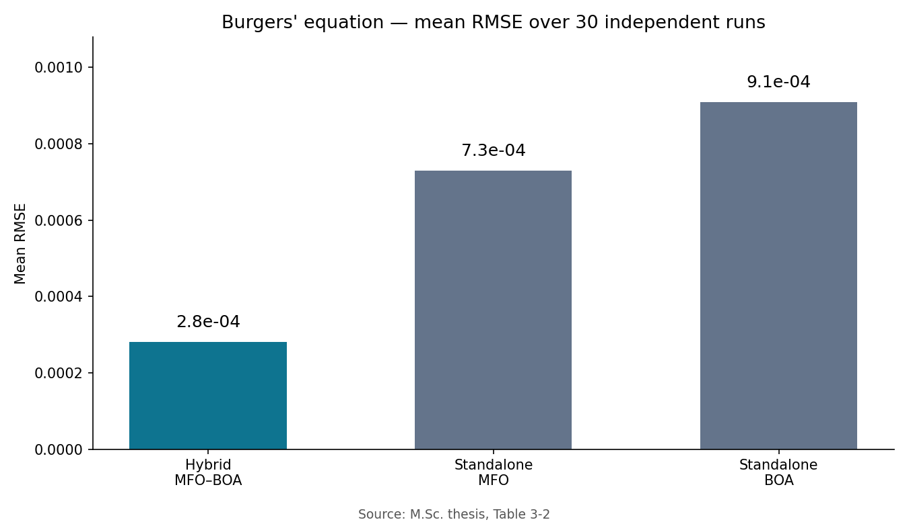

# MFO-BOA-PDE-Solver

Hybrid Moth-Flame Optimization (MFO) + Butterfly Optimization Algorithm (BOA) with B-spline collocation for solving nonlinear partial differential equations. M.Sc. thesis code, Damghan University (2026).

## What it does

- Searches PDE-solver configurations with a hybrid MFO–BOA metaheuristic.
- Discretizes with B-spline / cubic-spline collocation (`scipy.interpolate.BSpline`, `CubicSpline`).
- `notebook_code.py`: the solver (functions `run_seed`, `lstsq_fit`, `run_one`); `diag_eansatz2.py`: E-ansatz diagnostic — `(1-e^(-t))` envelope + exact boundary condition `u(x,0) = sin(x)`.

## Results

Burgers' equation: the hybrid MFO–BOA optimizer reduced RMSE by 62% versus standalone MFO and by 69% versus standalone BOA. Wilcoxon signed-rank tests: p = 0.003 versus MFO and p = 0.001 versus BOA. These results are from the M.Sc. thesis; this repository does not include a PINN baseline experiment.



| Method | Mean RMSE |
|---|---|
| Hybrid MFO–BOA | 2.8e-4 |
| Standalone MFO | 7.3e-4 |
| Standalone BOA | 9.1e-4 |

Mean RMSE on Burgers' equation over 30 independent runs (thesis Table 3-2).

## Requirements

- Python 3.10 or later, NumPy, SciPy, pandas, matplotlib; IPython for display; joblib optional (falls back to sequential execution).

## Installation

```bash
git clone https://github.com/Reza-S80/MFO-BOA-PDE-Solver.git
cd MFO-BOA-PDE-Solver
pip install -r requirements.txt
```

## Usage

Run the demo benchmark (NB_MODE=DEMO by default), or the full experiment with NB_MODE=FULL. The diagnostic replays segments of notebook_code.py — pass its path as an argument, or omit it to use the copy in the same directory:

```bash
python notebook_code.py
NB_MODE=FULL python notebook_code.py
python diag_eansatz2.py notebook_code.py
```

## Thesis

Solving Nonlinear Partial Differential Equations Using the Hybrid Moth-Flame and Butterfly Metaheuristic Algorithm and Its Applications in Engineering Problems — M.Sc. thesis, Damghan University, 2026.

## How to cite
If you use this code, please cite the M.Sc. thesis (see [CITATION.cff](CITATION.cff)):
> Sangari Abiz, R. (2026). Solving Nonlinear Partial Differential Equations Using the Hybrid Moth-Flame and Butterfly Metaheuristic Algorithm and Its Applications in Engineering Problems. M.Sc. thesis, Damghan University.

## License

MIT.

See [CHANGELOG.md](CHANGELOG.md) for version history.
